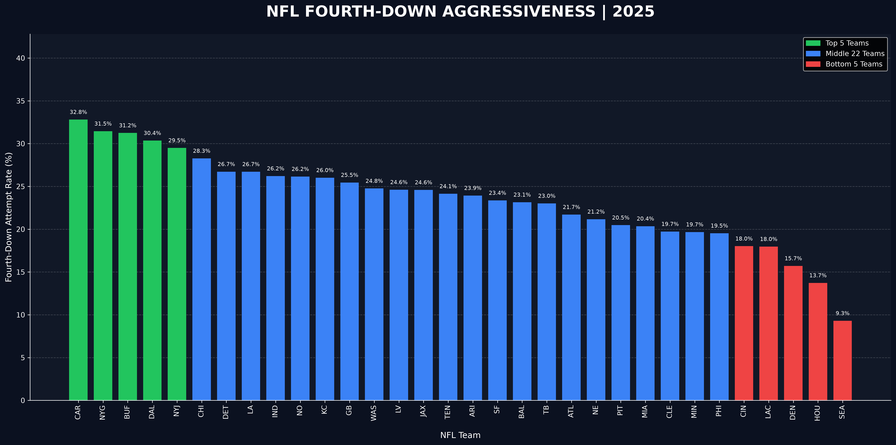
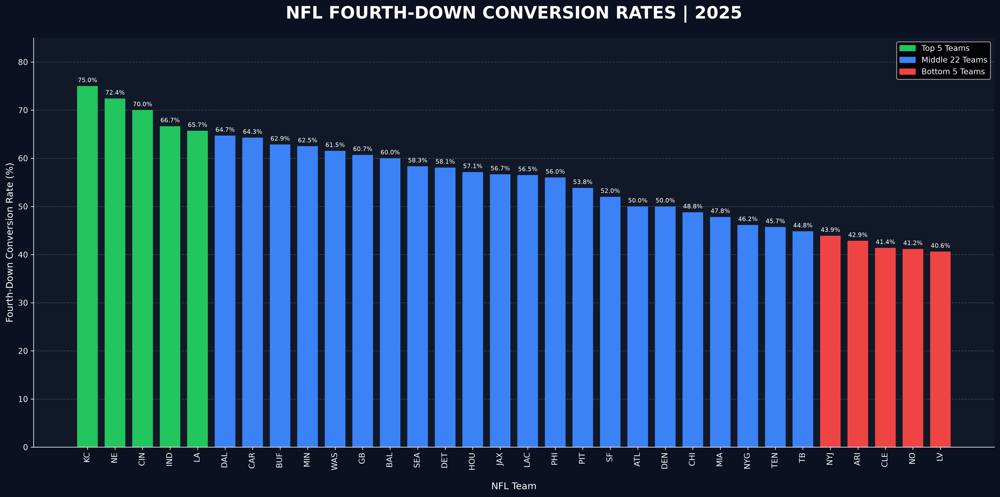
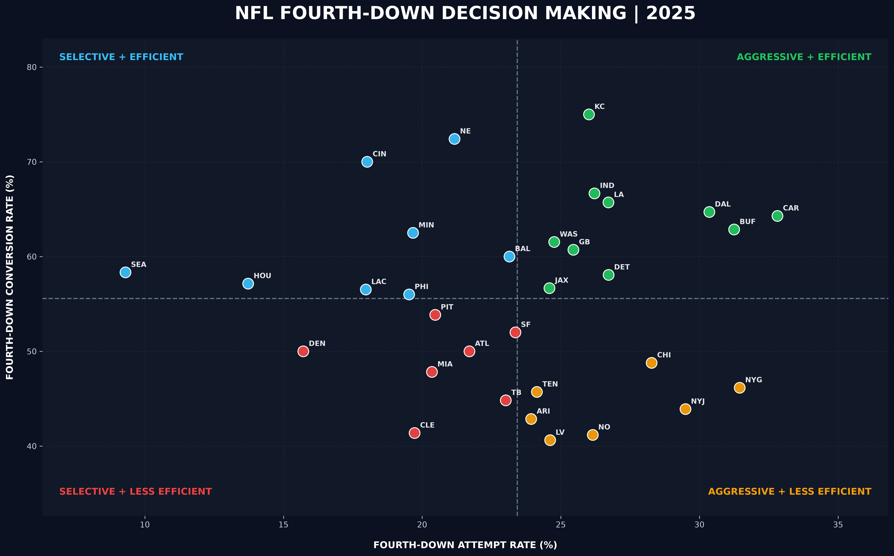
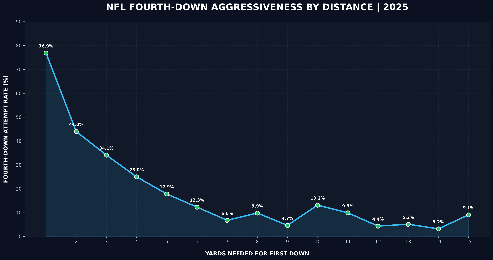
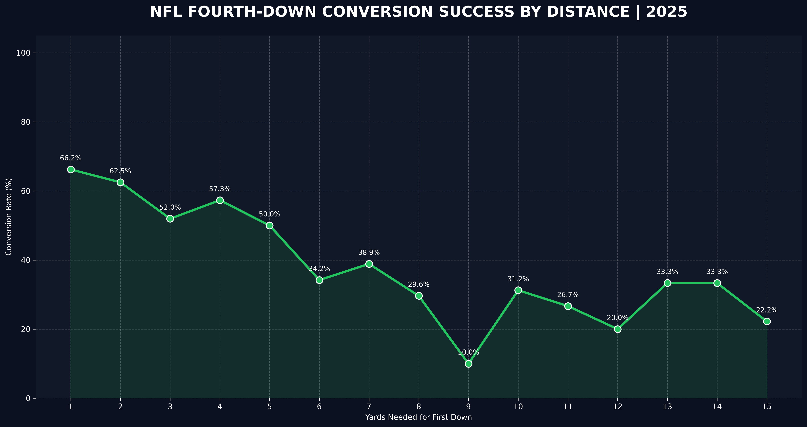
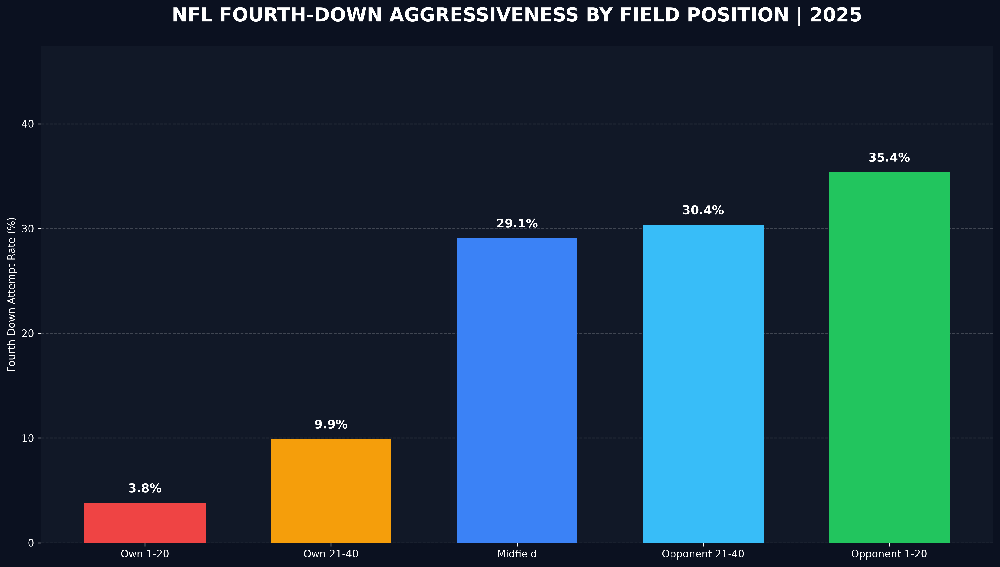
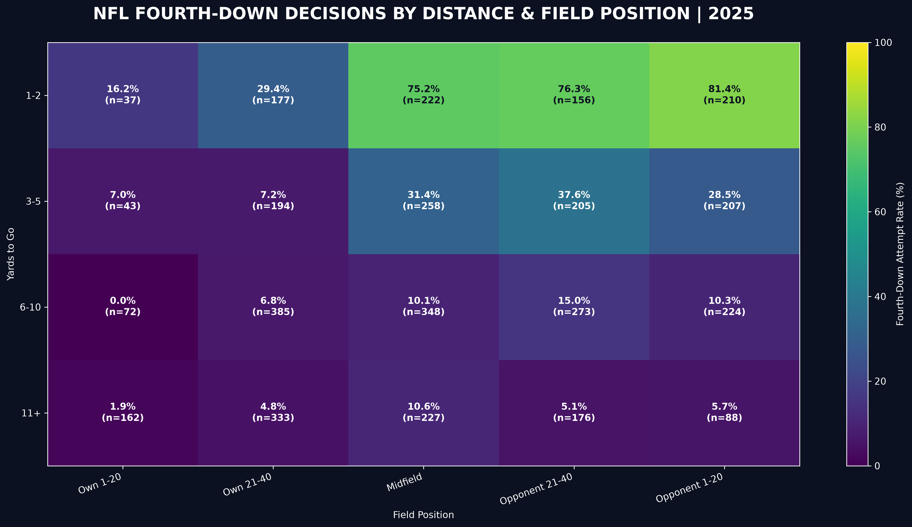
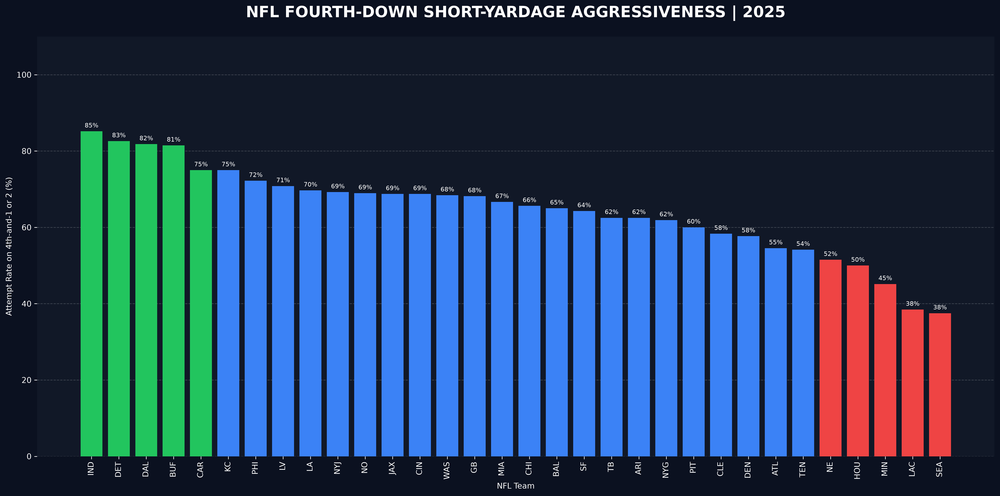

# NFL Fourth-Down Decision-Making Analysis | 2025

A Python data analytics project exploring how NFL teams approached fourth-down decisions during the 2025 season. The analysis compares how often teams went for it, how often those attempts succeeded, and how decisions varied by yards to gain and field position.

## Project overview

Fourth-down decisions involve a choice between attempting to gain a first down, punting, or kicking a field goal. This project uses NFL play-by-play data to answer four questions:

1. Which teams attempted fourth-down conversions most frequently?
2. Which teams converted the highest percentage of their attempts?
3. How did distance to the first down affect attempt and conversion rates?
4. How did field position relate to the decision to go for it?

## Tools

- **Python** for data analysis and scripting
- **nflreadpy / nflverse** for NFL play-by-play data
- **Polars** for filtering, grouping, joining, and aggregating data
- **NumPy** for numerical calculations
- **Matplotlib** for visualizations

## Key findings

Using the play definitions described below:

| Metric | Result |
| --- | ---: |
| Fourth-down opportunities | 3,997 |
| Fourth-down run/pass attempts | 931 |
| Successful conversions | 514 |
| League-wide attempt rate | 23.3% |
| League-wide conversion rate | 55.2% |
| Highest team attempt rate | Carolina Panthers — 32.8% |
| Highest team conversion rate | Kansas City Chiefs — 75.0% |

**Distance matters.** Teams attempted a conversion on **76.9% of fourth-and-1 opportunities**, compared with **44.0% on fourth-and-2** and **17.9% on fourth-and-5**.

**Field position matters, too.** Across all distances, the attempt rate was **3.8% inside a team's own 20** versus **35.4% inside the opponent's 20**. When facing fourth-and-1 or fourth-and-2, those rates were **16.2%** and **81.4%**, respectively.

These are descriptive associations, not evidence that a particular team's strategy was optimal. Team conversion rates also depend on the situations in which teams chose to attempt a conversion.

## Visualizations

### 1. Fourth-down aggressiveness by team



Teams ranked by the percentage of defined fourth-down opportunities on which they ran or passed.

### 2. Fourth-down conversion rates by team



Conversion percentage on fourth-down run/pass attempts, by team.

### 3. Aggressiveness vs. conversion success



The dashed lines show the unweighted averages across teams. Quadrant labels are relative to these averages, not judgments about optimal coaching.

### 4. Attempt rate by yards to go



Fourth-down attempt rates for distances of 1–15 yards.

### 5. Conversion Success by Yards to Go



Conversion rates among run/pass attempts, grouped by distance. Rates at longer distances may be based on smaller samples.

### 6. Attempt Rate by Field Position



How often teams went for it in different areas of the field.

### 7. Distance and Field-Position Heatmap



A combined view of yards to go and field zone. Each cell includes its number of opportunities (`n`).

### 8. Short-Yardage Aggressiveness by Team



Team-level attempt rates on fourth-and-1 and fourth-and-2 opportunities.

## Methodology

The script loads 2025 NFL play-by-play records using `nfl.load_pbp(2025)` and filters to plays where `down == 4`.

- **Fourth-down opportunity:** A fourth-down record whose `play_type` is `run`, `pass`, `punt`, or `field_goal`.
- **Fourth-down attempt:** A fourth-down opportunity whose `play_type` is `run` or `pass`.
- **Successful conversion:** An attempt where `fourth_down_converted == 1.0`.
- **Attempt rate:** `(run/pass attempts ÷ defined opportunities) × 100`.
- **Conversion rate:** `(successful conversions ÷ run/pass attempts) × 100`.

For field-position analysis, `yardline_100` represents the yards from the opponent's goal line. The five zones used are **Own 1–20** (81–99 yards from the opponent's goal), **Own 21–40** (61–80), **Midfield** (41–60), **Opponent 21–40** (21–40), and **Opponent 1–20** (1–20). The advanced analysis excludes records with missing distance or field position, and restricts these values to 1–99.

### Limitations and next steps

- The opportunity definition excludes `no_play` records, which may include penalties or other situations affecting a fourth-down decision. Those cases should be audited before treating the rankings as definitive.
- The project does not adjust for score differential, time remaining, opponent, expected points, or win probability.
- Conversion rates may be volatile for teams or distances with relatively few attempts.
- The exact set of games included by `nfl.load_pbp(2025)` should be verified (for example, whether postseason games are included) before making a regular-season-only claim.
- This is an observational analysis; it does not estimate whether going for it was the best decision in a given situation.

## Running the analysis

Install Python and the required libraries:

```bash
python -m pip install nflreadpy polars matplotlib numpy
```

From the project folder, run:

```bash
python load_data.py
```

The script generates PNG visualizations and CSV summaries. The initial charts are saved in the project root, while advanced outputs are saved in `project_outputs/`.

## Project structure

```text
nfl-fourth-down-analysis/
├── README.md
├── load_data.py
├── fourth_down_aggressiveness_2025.png
├── fourth_down_conversion_rates_2025.png
├── fourth_down_aggressiveness_vs_success_2025.png
├── fourth_down_attempt_rate_by_distance_2025.png
└── project_outputs/
    ├── conversion_success_by_distance.png
    ├── field_position_analysis.png
    ├── fourth_down_decision_heatmap.png
    ├── short_yardage_team_rankings.png
    ├── analysis_summary.txt
    └── *.csv
```

## What I learned

This project gave me hands-on experience working with a real-world dataset, defining measurable questions, building data transformations, calculating team-level metrics, and communicating findings through visualizations. It also reinforced the importance of checking definitions and sample sizes before interpreting results.

## Data source

NFL play-by-play data accessed through [nflreadpy](https://github.com/nflverse/nflreadpy), part of the [nflverse](https://github.com/nflverse) ecosystem.
